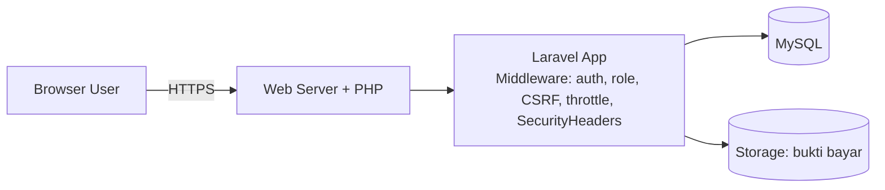

# ♻️ Sistem Iuran Sampah Desa

Aplikasi web untuk mengelola **iuran sampah warga desa**: pendataan warga, pembuatan tagihan bulanan, pembayaran digital (transfer bank / e-wallet / QRIS) dengan unggah bukti, verifikasi oleh admin, serta laporan rekap yang dapat diekspor ke **PDF** dan **Excel**.

> Tugas Project Mata Kuliah **Cyber Security** – Pengembangan & Pengamanan Aplikasi Web.

- **URL Aplikasi:** https://iuransampahdesa.free.nf
- **Repository:** https://github.com/20240810036-sys/sistem-iuran-desa

---

## ✨ Fitur

| Kategori | Fitur |
|---|---|
| Autentikasi | Registrasi warga, login, logout, "ingat saya" |
| Otorisasi (RBAC) | Peran **admin** dan **warga** (middleware `role`) |
| CRUD (Admin) | Data warga, tagihan, pembayaran, pengaturan metode pembayaran, user |
| Pembayaran | Warga memilih metode (bank/e-wallet/QRIS), unggah bukti; admin setujui/tolak |
| Laporan | Dashboard statistik, laporan pembayaran/tagihan/warga, ekspor **PDF** & **Excel** |
| Keamanan | Rate limiting login, password kuat, CSRF, security headers, **log aktivitas** (audit trail) |
| Warga | Dashboard, daftar tagihan, detail & bayar tagihan, riwayat pembayaran |

## 🧱 Teknologi

- **Backend:** Laravel 12 (PHP 8.1+)
- **Database:** MySQL / MariaDB
- **Frontend:** Blade + Bootstrap 5 + Bootstrap Icons (CDN)
- **Library:** `barryvdh/laravel-dompdf` (PDF), `maatwebsite/excel` (Excel)
- **Hosting:** InfinityFree (`iuransampahdesa.free.nf`) + HTTPS/SSL



## 🚀 Instalasi Lokal

```bash
git clone https://github.com/20240810036-sys/sistem-iuran-desa.git
cd sistem-iuran-desa
composer install
cp .env.example .env          # lalu isi konfigurasi database
php artisan key:generate
php artisan migrate --seed    # isi SEED_ADMIN_PASSWORD & SEED_WARGA_PASSWORD di .env dulu
php artisan storage:link
php artisan serve
```

Buka http://127.0.0.1:8000 (untuk lokal set `APP_ENV=local`, `APP_DEBUG=true`, `SESSION_SECURE_COOKIE=false`).

## ⚙️ Environment Variable

| Variabel | Keterangan |
|---|---|
| `APP_ENV` | `production` di server |
| `APP_KEY` | Dibuat dengan `php artisan key:generate` (rahasia) |
| `APP_DEBUG` | **`false`** di production |
| `APP_URL` | URL HTTPS aplikasi |
| `DB_HOST`, `DB_PORT`, `DB_DATABASE`, `DB_USERNAME`, `DB_PASSWORD` | Koneksi database (rahasia) |
| `SESSION_LIFETIME` | Masa berlaku sesi (menit), disarankan 30 |
| `SESSION_SECURE_COOKIE` | `true` → cookie hanya dikirim lewat HTTPS |
| `SESSION_ENCRYPT` | `true` → data sesi dienkripsi |
| `SEED_ADMIN_PASSWORD`, `SEED_WARGA_PASSWORD` | Password akun demo saat seeding |

> File `.env` **tidak** di-commit (ada di `.gitignore`).

## 🔐 Penerapan Keamanan

| Aspek | Implementasi | Lokasi |
|---|---|---|
| Hashing password | bcrypt (cast `hashed` / `Hash::make`) | `app/Models/User.php` |
| Kebijakan password | Min 8, huruf besar+kecil, angka, simbol; cek kebocoran (HIBP) di production | `AppServiceProvider`, `RegisterRequest` |
| SQL Injection | Eloquent / Query Builder (prepared statement), validasi Form Request | `app/Http/Requests/*` |
| XSS | Escaping Blade `{{ }}`, `strip_tags` input registrasi, CSP header | views, `SecurityHeaders` |
| CSRF | Token `@csrf` + middleware `VerifyCsrfToken` | semua form |
| Sesi | Cookie HttpOnly, Secure, SameSite=Lax, terenkripsi, regenerate saat login, invalidate saat logout | `config/session.php`, `AuthController` |
| Rate limiting | Login 5x/menit per email+IP, register 5x/menit | `AuthController`, `routes/web.php` |
| RBAC | Middleware `role:admin` / `role:warga` | `RoleMiddleware`, `routes/web.php` |
| IDOR | Cek kepemilikan tagihan sebelum ditampilkan/diunggah | `Warga/TagihanWargaController` |
| Mass assignment | Role registrasi dipaksa `warga` | `AuthController@register` |
| Security headers | CSP, X-Frame-Options, X-Content-Type-Options, Referrer-Policy, Permissions-Policy, HSTS | `app/Http/Middleware/SecurityHeaders.php` |
| Audit trail | Log login/gagal/blokir/logout/registrasi/CRUD user | `ActivityLog`, menu **Log Aktivitas** |
| Secret | Semua kredensial di `.env` | `.env.example` |

## 🧪 Self-Testing Keamanan

Pengujian otomatis: `php artisan test --filter=SecurityTest`

| No | Skenario | Cara Uji | Hasil | Perbaikan |
|---|---|---|---|---|
| 1 | Password disimpan ter-hash | Registrasi lalu cek kolom `password` | ✅ Lolos (bcrypt `$2y$`) | – |
| 2 | Password lemah ditolak | Registrasi dengan `123456`, `password` | ✅ Lolos | **Sebelumnya** min 6 karakter → diganti kebijakan password kuat |
| 3 | Privilege escalation via registrasi | Kirim field `role=admin` | ✅ Lolos (tetap warga) | Fitur registrasi baru, role di-hardcode |
| 4 | Brute force login | 6x login salah berturut-turut | ✅ Lolos (diblokir 60 detik) | **Sebelumnya** tanpa batas → ditambah RateLimiter |
| 5 | SQL Injection login | `' OR '1'='1' --` | ✅ Lolos | – |
| 6 | XSS stored | Nama warga `<script>alert(1)</script>` | ✅ Lolos (di-escape) | – |
| 7 | Akses halaman admin oleh warga | Buka `/admin/*` sebagai warga | ✅ Lolos (403) | – |
| 8 | IDOR tagihan warga lain | Ubah ID di `/warga/tagihan/{id}` | ✅ Lolos (403) | – |
| 9 | CSRF | POST tanpa token | ✅ Lolos (419) | – |
| 10 | Security headers | Cek header response / securityheaders.com | ✅ Lolos | **Sebelumnya** tidak ada → middleware `SecurityHeaders` |
| 11 | Logout & sesi | Logout lalu akses dashboard | ✅ Lolos (redirect login) | – |
| 12 | Secret di repository | `git log -- .env`, cek `.gitignore` | ✅ Lolos | Password seeder dipindah ke env |
| 13 | Dependency rentan | `composer audit` | Lihat laporan | `composer update` |

## 🤖 Penggunaan AI Agent

| Alat | Bagian | Contoh Prompt |
|---|---|---|
| _isi: mis. ChatGPT / Claude / Antigravity_ | Rancangan CRUD & fitur pembayaran | "Buatkan fitur pembayaran digital dengan upload bukti dan verifikasi admin di Laravel 10" |
| Antigravity (Claude) | Registrasi, rate limiting, security headers, log aktivitas, test keamanan | "Lengkapi aplikasi sesuai ketentuan tugas Cyber Security: registrasi, keamanan, dan self-testing" |

Semua kode hasil AI ditinjau ulang, dijalankan, dan diuji (lihat `tests/Feature/SecurityTest.php`). Tidak ada secret/data asli yang dimasukkan ke prompt.

## 📄 Lisensi
MIT – untuk keperluan akademik.
